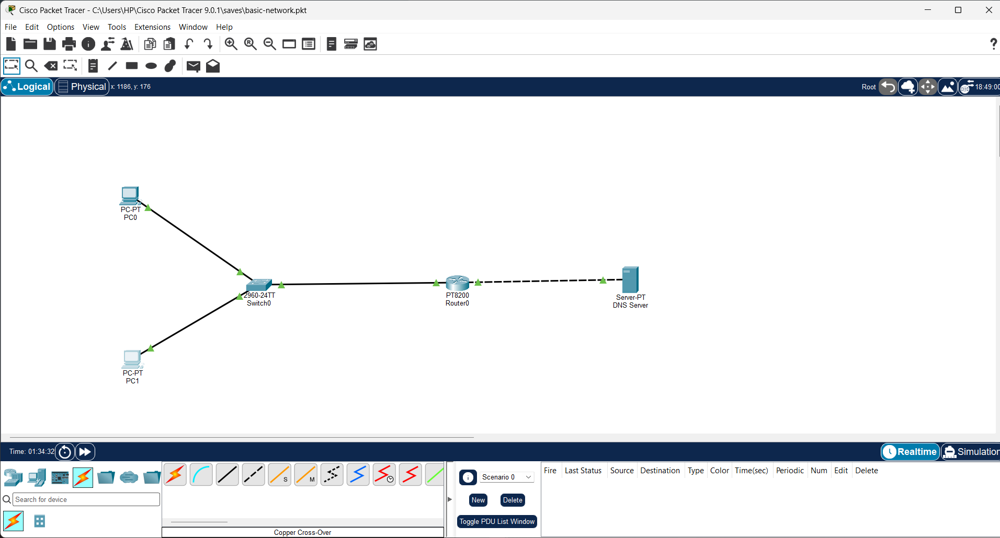
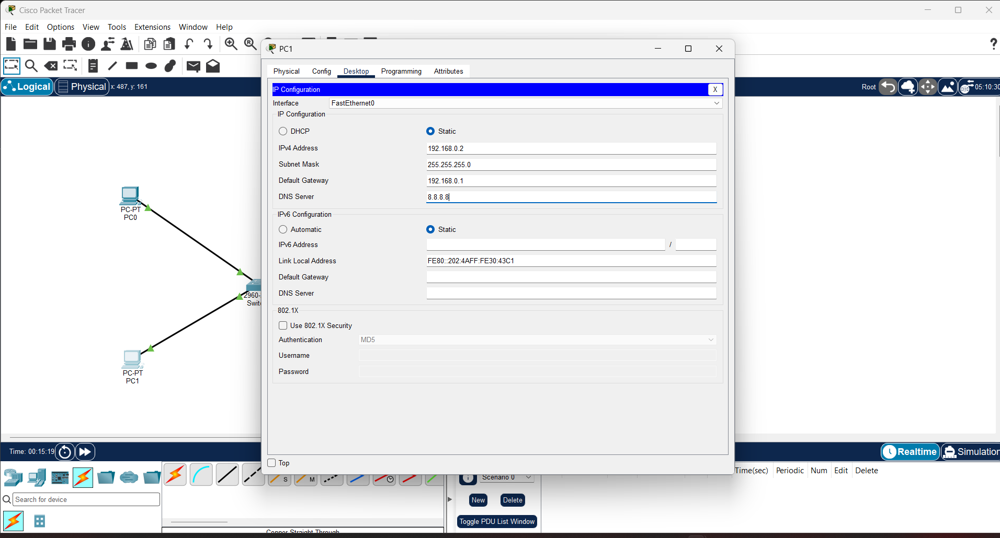
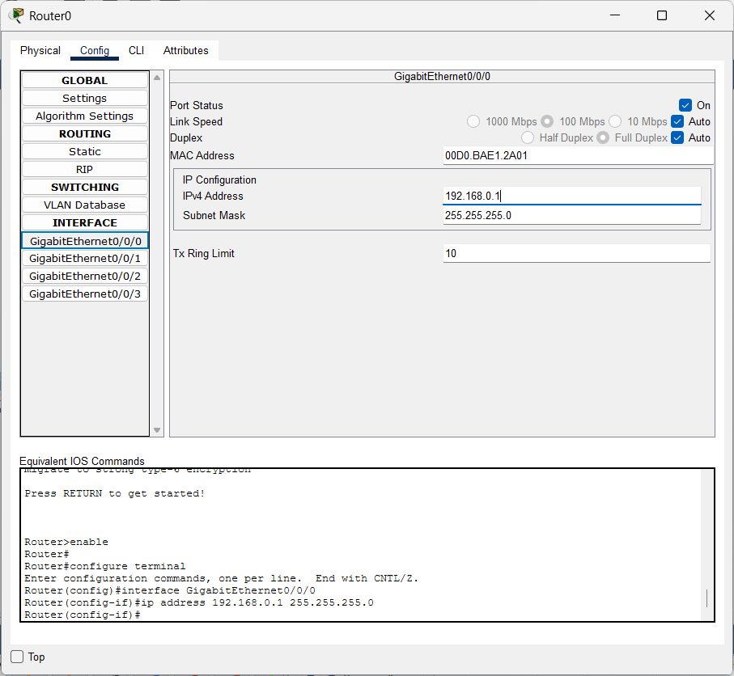
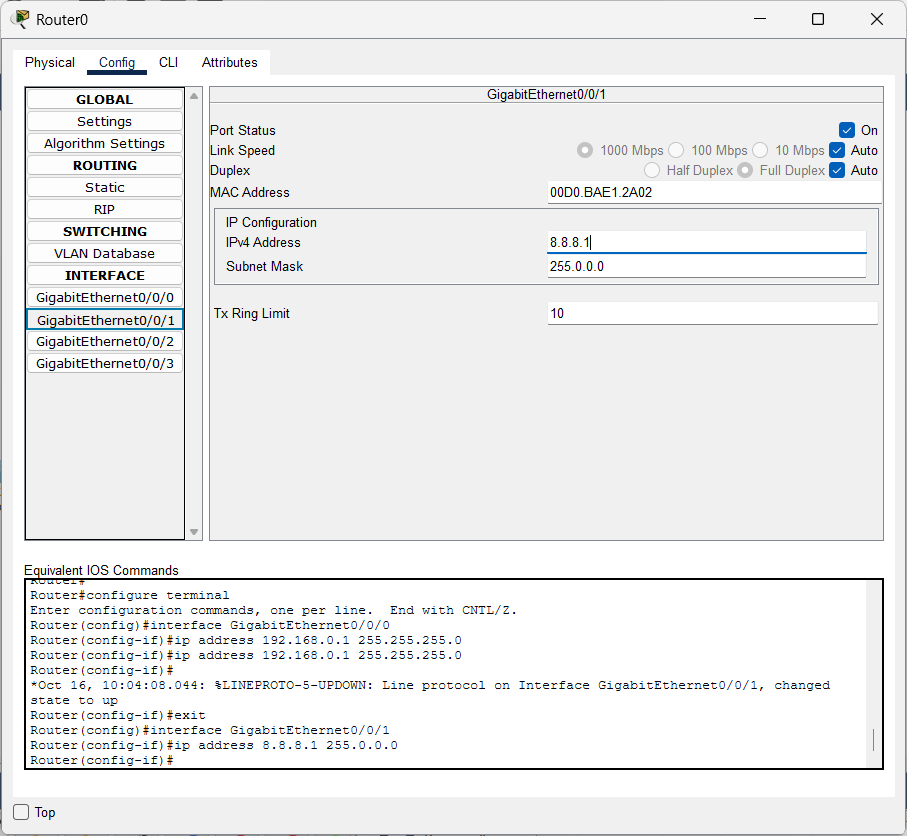
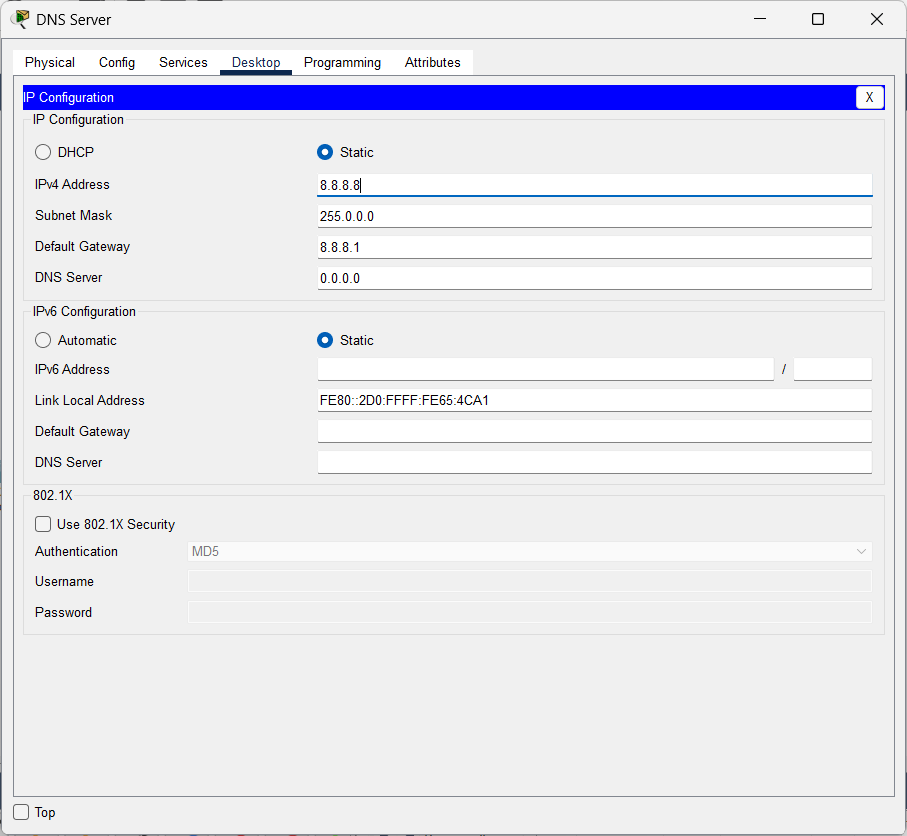
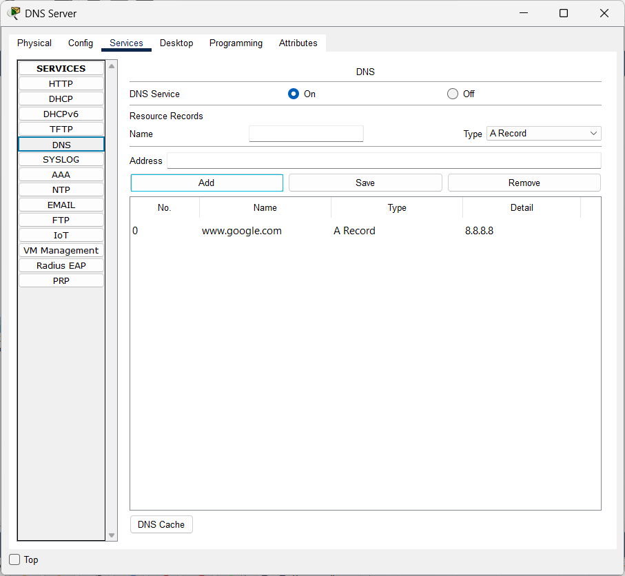
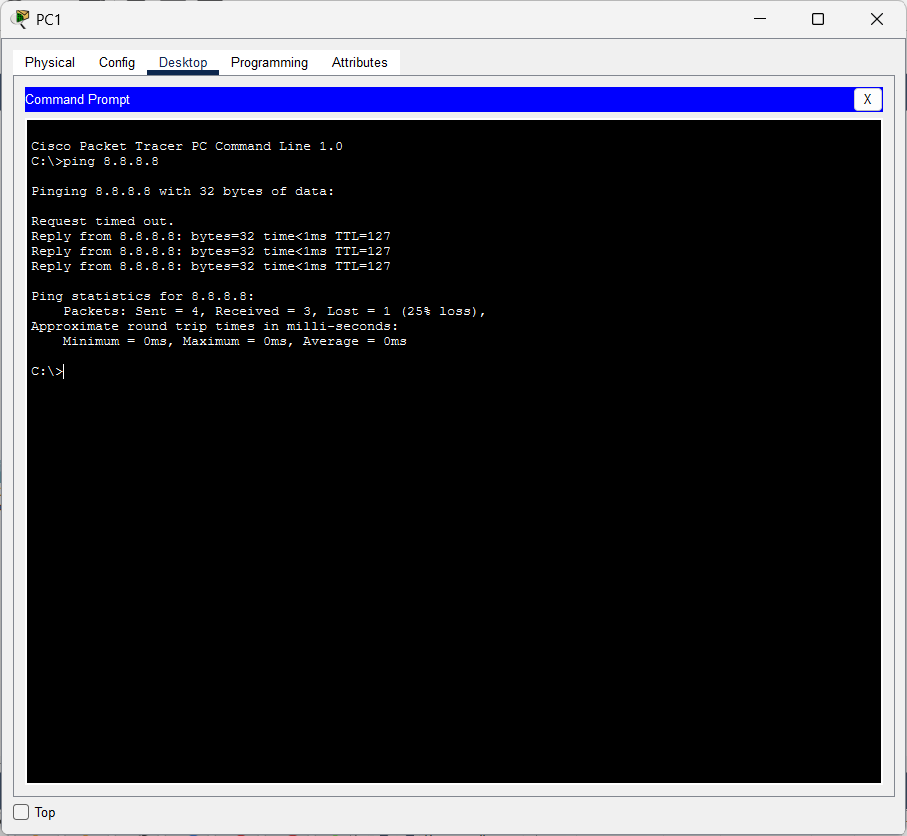
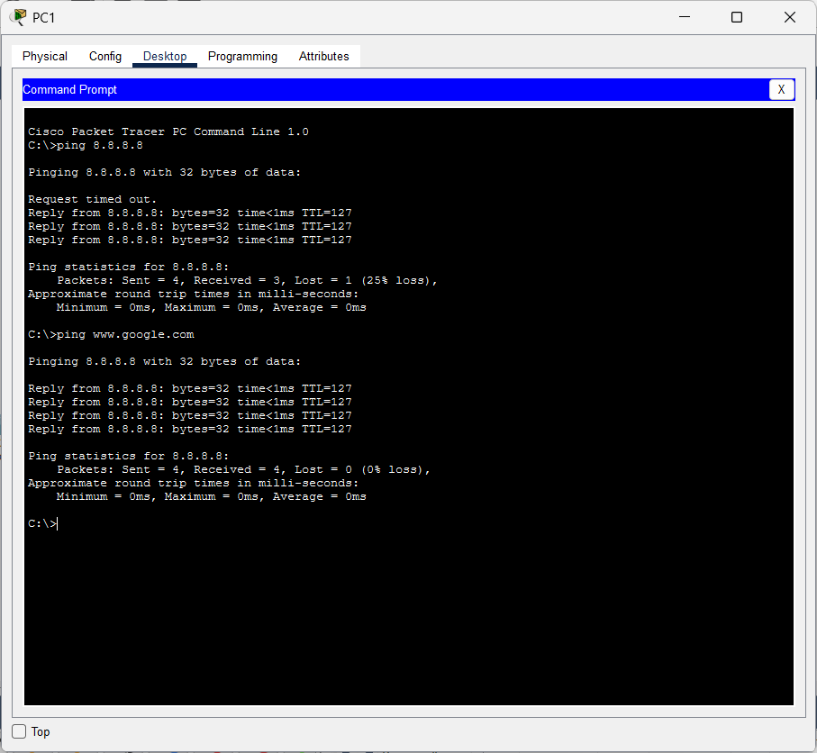
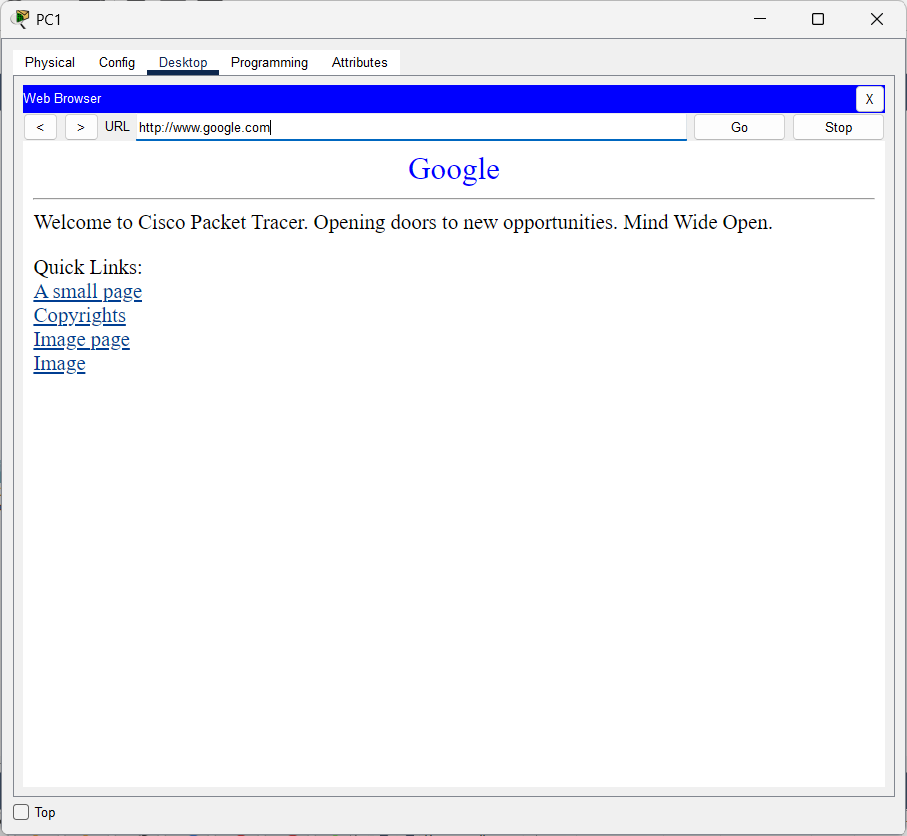

# Cisco Packet Tracer Lab: LAN, Router and Google DNS Simulation

A networking lab built in Cisco Packet Tracer. Two PCs connect through a switch to a router, and the router connects to a server that simulates Google's DNS and web service. The lab demonstrates static IP addressing, default gateways, routing between two networks, and DNS name resolution.

## Objectives
- Connect two PCs to a switch and the switch to a router
- Configure static IP addresses on the PCs, router interfaces and server
- Configure a DNS server that resolves `www.google.com` to `8.8.8.8`
- Verify connectivity with ping and the PC web browser

## Topology

```
PC0 (192.168.0.3) ---\
                      [Switch0 2960] --- Gi0/0/0 [Router0 PT8200] Gi0/0/1 === [DNS Server 8.8.8.8]
PC1 (192.168.0.2) ---/                  192.168.0.1                8.8.8.1
```

`---` straight-through cable, `===` cross-over cable.



## Devices
| Device | Model |
|---|---|
| Switch0 | Cisco 2960-24TT |
| Router0 | Cisco PT8200 |
| End devices | 2 x PC-PT, 1 x Server-PT (DNS Server) |

## Addressing Table
| Device | Interface | IP Address | Subnet Mask | Default Gateway | DNS Server |
|---|---|---|---|---|---|
| PC1 | FastEthernet0 | 192.168.0.2 | 255.255.255.0 | 192.168.0.1 | 8.8.8.8 |
| PC0 | FastEthernet0 | 192.168.0.3 | 255.255.255.0 | 192.168.0.1 | 8.8.8.8 |
| Router0 | Gi0/0/0 | 192.168.0.1 | 255.255.255.0 | N/A | N/A |
| Router0 | Gi0/0/1 | 8.8.8.1 | 255.0.0.0 | N/A | N/A |
| DNS Server | FastEthernet0 | 8.8.8.8 | 255.0.0.0 | 8.8.8.1 | N/A |

## Cabling
| From | To | Cable |
|---|---|---|
| PC0 | Switch0 | Copper straight-through |
| PC1 | Switch0 | Copper straight-through |
| Switch0 | Router0 Gi0/0/0 | Copper straight-through |
| Router0 Gi0/0/1 | DNS Server | **Copper cross-over** |

A cross-over cable is used between the router and the server because they are unlike-pair devices that both transmit on the same pins (router interface to end device), so the transmit and receive pairs must be swapped. In Packet Tracer this link shows as a dashed line.

## Configuration Steps

### 1. Build the topology
Add two PCs, a 2960 switch, a PT8200 router and a server, then connect them with the cables listed above. The build-up is shown in [`screenshots/build-steps/`](screenshots/build-steps/).

### 2. Configure the PCs
Static IP, subnet mask 255.255.255.0, default gateway 192.168.0.1 and DNS server 8.8.8.8.



### 3. Configure the router interfaces
Commands are in [`configs/router-config.txt`](configs/router-config.txt).




### 4. Configure the DNS server
Static IP 8.8.8.8, mask 255.0.0.0, default gateway 8.8.8.1.



Turn the DNS service on and add the A record `www.google.com` -> `8.8.8.8`. The HTTP and HTTPS services are also on.



## Verification

| Test | Result |
|---|---|
| PC1 ping 8.8.8.8 | 3 of 4 replies. The first request timed out, which is normal on a first ping while ARP resolves the gateway's address |
| PC1 ping www.google.com | 4 of 4 replies. The name resolved to 8.8.8.8 |
| PC1 web browser to http://www.google.com | Web page loaded |





## Repository Structure
```
.
├── README.md
├── configs/router-config.txt
├── topology/            <- Packet Tracer file (basic-network.pkt)
└── screenshots/
    ├── 01-topology-final.png ... 09-web-browser-test.png
    └── build-steps/
```

## What I Learned
- Each router interface sits in its own network and acts as the default gateway for that network.
- A device sends traffic for a different network to its default gateway.
- DNS translates a name (`www.google.com`) into an IP address before the connection is made.
- Router-to-end-device links need a cross-over cable, while end device-to-switch links use straight-through.
- The first ping often drops one packet because ARP has to resolve the gateway's MAC address first.

## Tools
Cisco Packet Tracer 9.0.1

## Author
Osasogie Justice Osunde
